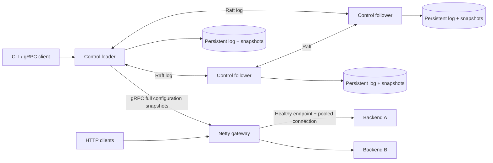

# Raft KV & Gateway

[](https://github.com/TongTong0828/raft-kv-gateway/actions/workflows/ci.yml)

A Java 21 distributed-systems project combining a durable, three-node Raft KV store with a bounded, nonblocking HTTP gateway. Apache Ratis provides consensus. Netty handles the data plane, and gRPC distributes versioned routing configuration.

The project focuses on failure behavior that can be reproduced locally: revision-checked writes, leader isolation, snapshot installation, configuration outages, connection reuse, overload rejection, and resource cleanup.

**Local 64/256-VU sustained performance passed:** three five-minute runs per cohort delivered **8,390.65–8,395.59 successful requests/s at 64 VUs** and **8,363.66–8,381.35/s at 256 VUs**, with successful full-call **P99 0.82–1.05 ms** and **3.81–6.71 ms** respectively, exact 1 KiB bodies, and zero eligible failures or unaccounted outcomes. The 64-VU standard profile uses service admission 100 and a 768 MiB generator; the 256-VU burst profile explicitly uses admission 256 and a 1,536 MiB generator. See [burst handling, per-run outcomes and retained failed experiments](docs/burst-handling.md).

**Actual AWS EKS acceptance remains deferred:** the owner has no AWS account and declined paid resources. No local result establishes an AWS deployment or NLB performance result. See [acceptance status](docs/acceptance-targets.md). Earlier [32-VU passes](docs/benchmarks.md#strict-sustained-local-acceptance) and [503 diagnoses](docs/backpressure.md) remain historical evidence.

## Architecture



Routing specifications live under `/services/{id}` in the replicated KV store. The gateway validates each full configuration, installs an immutable routing table, and forwards directly to backends. HTTP business requests do not pass through Raft. The KV interface itself is gRPC, available through the CLI.

| Module | Responsibility |
|---|---|
| `api` | Protobuf protocol, configuration validation, settings |
| `control-plane` | Ratis state machine, CAS, durable snapshots, strong reads, bounded Watch |
| `gateway` | Routes, admission budgets, health probes, asynchronous pools, HTTP lifecycle |
| `cli` | Leader discovery and KV/service commands |
| `demo-backend` | Fixed 1 KiB responses and configurable delay/failure |
| `integration-tests` | Real-network acceptance driver and bounded history checker |

See [architecture and consistency](docs/architecture.md), [commands and protocol](docs/usage.md), and [failure verification](docs/recovery.md).

## Quickstart

Requirements: Docker Engine 28+ with Compose 2.33.1+ and a Bash-compatible shell. No host JDK or cloud account is required. The six application containers have a combined memory limit of **1,984 MiB**; the image builder and temporary tools run separately.

```bash
git clone https://github.com/TongTong0828/raft-kv-gateway.git
cd raft-kv-gateway
./scripts/dev.sh build
./scripts/dev.sh up
./scripts/dev.sh smoke
curl -i http://localhost:8080/orders/item
```

The smoke command seeds the sample service using its current revision and checks both backend IDs and the 1 KiB payload. It also checks that request resources return to zero. Running it again is supported.

```bash
./scripts/cli.sh status
./scripts/cli.sh kv put greeting hello --expected-revision 0
./scripts/cli.sh kv get greeting
./scripts/cli.sh service get orders
./scripts/cli.sh watch
./scripts/dev.sh down       # preserves node volumes
./scripts/dev.sh reset      # explicitly deletes this Compose project's volumes
```

Reads print JSON; raw KV bytes are base64 encoded. To update or delete an existing key, use its returned `modRevision`. For service changes, use the service's returned `revision`. See the [usage guide](docs/usage.md) for examples and port overrides.

## Verified behavior

| Capability | Evidence |
|---|---|
| CAS, delete/recreate revision safety, durable restart, real gRPC Watch | Java test suite: `./scripts/mvn.sh verify` |
| Old leader rejects a strong read; majority commits; old Watch is fenced | [Current Docker fault run](docs/results/burst-local-v1/verification/burst-faults.json) |
| Lagging follower installs a snapshot after missing logs are purged | [Install counter and index evidence](docs/results/burst-local-v1/verification/burst-faults.json) |
| Cached routing during full control outage; atomic route-table replacement | [Current fault assertions and traffic evidence](docs/results/burst-local-v1/verification/burst-faults.json) |
| Global body budget, overload rejection, cancellation cleanup | Real HTTP tests and [80-service body-budget run](docs/results/burst-local-v1/verification/burst-faults.json) |
| Three Raft voters on one kind node, three PVCs, pod replacement, gateway rollout | [Current local Kubernetes validation](docs/results/burst-local-v1/verification/burst-kind.json) |
| EKS gp3 / LoadBalancer configuration | [Render-checked deployment example](deploy/kubernetes/README.md); **not deployed to AWS** |
| Bounded FIFO, available-slot dispatch, cancellation/deadline/retirement ownership | [Real-network regressions and burst verification](docs/burst-handling.md) |
| HTTP and direct-KV performance | [Benchmark method and measured results](docs/benchmarks.md) |

The six selected local runs each used 8,400 offered requests/s, 30 seconds warmup and 300 seconds measurement. Every ten-second bucket exceeded 8,000 successful requests/s (lowest: 8,115.30/s), with zero eligible failures or unaccounted outcomes. Whole-experiment generator drops, including warmup, totalled 8,767 for the 64-VU cohort and 22,728 for the 256-VU cohort; they are excluded from successes. The cohorts have different service and generator budgets and are reported separately. The earlier failed 256-VU/768 MiB series, invalid timing exports, historical 32-VU passes and original 30-run matrix remain public. See [current burst verification](docs/burst-handling.md) and [historical methods and results](docs/benchmarks.md).

The Docker and kind scripts create isolated resources and clean up only resources they own. Fault and Kubernetes tooling additionally require Python 3.9+ and curl.

```bash
python3 scripts/faults.py --output work/fault-results.json
./scripts/kind-smoke.sh --output work/kind-results.json
```

## Contracts and limits

- Three fixed voters, quorum of two. Leader reads use quorum-confirmed ReadIndex; there are no follower reads or lease reads.
- Create with expected revision `0`; update/delete with the current modification revision. Successful revisions are Raft log indices. A timed-out submitted mutation has an **unknown outcome**: read and reconcile it before deciding on another operation. The application client does not automatically retry mutations.
- The gateway keeps the latest valid configuration in memory during an outage. A restarted gateway needs the control plane again. Empty valid configuration returns 404; no initial configuration returns 503.
- HTTP/1.1 sequential keep-alive, bounded bodies up to 1 MiB, segment-prefix routing without path rewriting. No HTTP/2 proxying, WebSocket, CONNECT, pipelining, trailers, streaming, or `Expect: 100-continue` support.
- Per service, per gateway process: default 100 inflight exchanges and 16 connections per endpoint. Admitted requests share a bounded service FIFO under their original total deadline; dispatch selects a healthy endpoint with a free slot. The explicit burst example uses service inflight 256. Endpoint pools retain a separate 32-pending-acquisition / 100 ms native guard. Global limits: 256 exchanges, 512 business connections, 2,048 downstream connections, and 64 MiB of held aggregate body bytes. Saturation returns 503; upstream failure returns 502; total deadline returns 504.
- Health probes use separate connections. Endpoints require a successful initial probe; three failures mark unhealthy and two probe successes recover them. No request is retried against another endpoint.

This is a personal learning project, not a production database or an internet-facing security boundary. It has no dynamic Raft membership, sharding, TTL, authentication, or TLS. Configuration and management interfaces assume a trusted network. Read [security and deployment boundaries](SECURITY.md).

## Build, test, and contribute

```bash
./scripts/mvn.sh verify
python3 -m unittest discover -s benchmarks -p 'test_*.py'
python3 -m unittest discover -s benchmarks/k6 -p 'test_*.py'
node --test benchmarks/test_*.mjs
python3 scripts/audit-release.py
```

Versions and container digests are pinned. Benchmarks use a [locally patched monotonic k6 generator](benchmarks/k6/README.md), built with `./scripts/k6.sh build` (Python 3.12+, Git and Docker); the runner verifies and executes its immutable image ID. CI runs Java and generator tests, distribution checks, Compose smoke/fault tests, and Kubernetes rendering. Hardware-dependent throughput is reported separately. See [CONTRIBUTING](CONTRIBUTING.md).

Original source is [Apache-2.0](LICENSE). Dependencies retain their own licenses; see [NOTICE](NOTICE) and [distribution notices](distribution/README.md).
