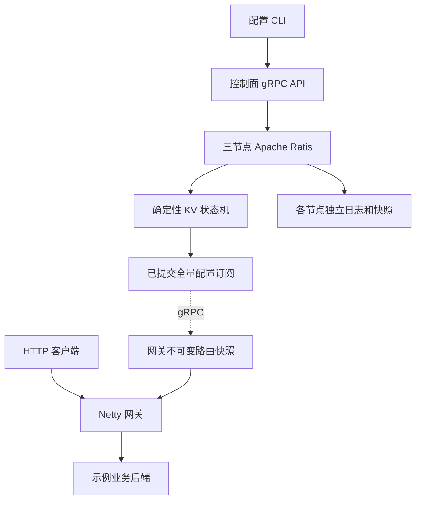

# Raft KV & Gateway v1 设计规格

日期：2026-10-18。状态：用户已批准规格，并授权编写实施计划后继续实现。

## 1. 目标与完成标准

把已讨论的 Distributed KV Store & Gateway 实现为可复现、可解释、可开源的个人项目。暂定仓库名 `raft-kv-gateway`，目标 GitHub 账户为当前已登录的 `TongTong0828`，使用 Apache-2.0 许可证。仓库名和许可证是本规格选择的默认值，用户可以修改。

最终交付必须包括真实运行的三节点 Ratis KV、Netty HTTP 网关、gRPC 配置分发、配置 CLI、示例后端、自动化测试、容器启动方式、Kubernetes 部署配置、CI、中英文说明和真实实验记录。主 README 使用英文，提供 `README.zh-CN.md`。

新用户在安装 Git、Docker Engine/Desktop 与 Docker Compose v2 后，能够从干净克隆启动整个系统、注册示例服务、访问网关、修改路由并执行烟雾测试。Java/Maven 的宿主机安装不是快速开始的前置条件。

成功标准是功能、恢复和资源边界可验证。8,000 requests/s 和 15 ms P99 是旧聊天的示例，不作为已完成成果，也不作为第一版的硬件相关验收门槛。

## 2. 实现路径选择

选择 Java 单仓库、Maven 多模块、Apache Ratis 共识库、应用层 gRPC 和 Netty 网关。这保留原方案的工程重点，并能在个人项目规模内做出完整故障实验。

比较过的替代路径：手写 Raft 会显著增加协议正确性工作，推迟网关和恢复验证；依赖外部 etcd/成熟网关可以缩短交付，但无法展示本项目的 KV 状态机、配置安装和代理资源管理。v1 采用 Ratis，不实现自己的选举和日志复制协议。

## 3. 第一版范围

包含：固定三名投票节点；通用 KV 的 Get/条件 Put/条件 Delete；线性一致读取；状态机版本检查；持久化日志、快照和恢复；服务配置全量订阅；本地原子路由切换；HTTP/1.1 有界请求转发；连接池、健康探测、每服务并发限制、deadline；Docker Compose；本地 Kubernetes 验证与 EKS 部署示例；故障与性能实验。

v1 不包含动态 Raft 成员变更、分片、多地域、租约/TTL、自动 Kubernetes 服务注册、全局 QPS 限流、业务请求自动重试、WebSocket/CONNECT、HTTP/2 代理、无限流式正文或持久化网关配置缓存。服务实例通过 CLI 显式注册。网关运行时保留最近有效配置；重启后必须重新获取配置。

控制管理端口仅在本机、容器内部网络或 Kubernetes ClusterIP 暴露。该版本不承担公开互联网管理 API 的身份认证产品功能；公开入口只指向业务网关。

## 4. 架构与模块边界

Maven 模块职责：

| 模块 | 责任 | 明确的边界 |
|---|---|---|
| `api` | Protobuf 消息与生成的应用 gRPC 接口 | 不引用 Ratis 内部 shaded 消息 |
| `control-plane` | Ratis 节点、KV 状态机、应用 RPC、配置订阅、管理状态 | 每个进程运行一个固定成员；持有自己的数据目录 |
| `gateway` | 配置客户端、路由快照、健康状态、代理、连接池和并发控制 | 业务请求不查询控制面 |
| `cli` | 状态检查、KV 操作、服务配置管理与观察 | 通过应用 RPC 通信，不直接操作存储 |
| `demo-backend` | 可识别实例、固定大小响应、可控慢响应与失败 | 仅用于演示和可重复实验 |
| `integration-tests` | 跨模块、真实节点和端到端验证 | 对外部行为与故障结果断言 |

配置 API、KV 和发布器是同一控制面进程内的模块。每个节点暴露应用 gRPC 端口 `50051`、Ratis 通信端口 `6000`、内部管理 HTTP 端口 `9101`。网关业务端口为 `8080`，内部管理端口为 `9090`。Compose 为三个节点分别映射宿主机应用 RPC 端口 `15051`、`15052`、`15053`，管理端口不默认公开到局域网。

## 5. 固定技术版本与依赖隔离

截至规格日期，读取官方发布记录与元数据后选择：

| 组件 | 固定版本 |
|---|---|
| Java | Temurin 21 LTS，编译目标 21 |
| Maven | 3.9.16 |
| 构建镜像 | `maven:3.9.16-eclipse-temurin-21-noble` |
| Apache Ratis | 3.3.1，Ratis 模块统一版本 |
| 网关 Netty | 4.2.19.Final，以 `netty-bom` 对齐 |
| 应用 gRPC Java | 1.85.0，以 `grpc-bom` 对齐，传输使用 `grpc-netty-shaded` |
| 应用 protobuf-java 与 protoc | 均为 3.25.9 |
| protobuf-maven-plugin | 0.6.1 |
| os-maven-plugin | 1.7.1 |
| protoc-gen-grpc-java | 1.85.0 |
| JUnit | 5.14.4 |
| Surefire / Failsafe | 3.5.5 |
| 压测工具 | `grafana/k6:2.3.0` |

Ratis 自身使用重定位的 protobuf/gRPC/Netty。应用协议与 Ratis 的边界传递序列化字节，禁止把两种 namespace 的消息混用。应用 BOM 不覆盖 Ratis shaded 依赖；发布检查单独记录其中的版本。使用 glibc 镜像，避免 protoc 插件与 Alpine/musl 的兼容问题。

镜像 tag 必须固定；实现时将已验证的多架构 digest 写入构建配置。Maven 构建镜像 index digest 为 `sha256:99e61abcff91a9b1333463bd8451fb18495d6eba9250ac66a338b518f8278320`；k6 index digest 为 `sha256:9c2dee7f8ed74d317e4027c06a10f169b625638189de8d4555d0b3486a5aeb34`。

## 6. KV、一致性与持久化契约

固定三个 voters，group ID 和 peer 地址由显式配置提供。多数派为两个。成功写响应只能发生在命令已经提交并被本地状态机应用之后；孤立少数派不能确认新写入。

Get 必须走 Leader 的线性一致读路径，确保读屏障和对应已提交状态已经应用。非 Leader 的应用 API 返回 `FAILED_PRECONDITION` 与可识别的 Leader hint；未知 Leader 时返回 `UNAVAILABLE`。CLI 与网关配置客户端使用三个 seed 地址发现 Leader。GetStatus 在所有节点可读，明确标注为诊断状态；API 不把普通 Follower 本地读取称为强一致读取。

KV key 为非空 UTF-8 字符串，最大 256 字节；value 最大 64 KiB。最多 1,024 条记录，累计 key/value 字节不超过 4 MiB。超限操作在状态机中确定性拒绝。`/services/{serviceId}` 是服务配置保留命名空间，value 必须是合法序列化 `ServiceSpec`；serviceId 匹配 `[a-z][a-z0-9-]{0,62}`。

每条存活记录保存 `value` 和 `modRevision`。成功修改的 `modRevision` 使用对应已提交 Raft 日志 index，允许有间隙。全局 `stateRevision` 是最近一次成功 KV 修改的 revision。删除后重新创建获得新 revision，因此旧版本不能通过 ABA 误匹配。

Put 必须传 `expectedRevision`：0 表示仅当 key 不存在时创建，正值表示仅当当前 revision 相等时替换。Delete 要求正的预期 revision。版本比较与修改在同一个确定性状态机操作中完成；失败 CAS 不改变用户状态或 `stateRevision`。所有状态机修改按 Raft 提交顺序实际完成，不在异步任务中无序修改 map。

输入非法返回 `INVALID_ARGUMENT`，读不存在返回 `NOT_FOUND`，CAS 冲突返回 `ABORTED` 并包含当前 revision；失去可用 Leader/多数派或服务停止返回 `UNAVAILABLE`，RPC 到期返回 `DEADLINE_EXCEEDED`。错误不泄露服务端堆栈。

写入提交后发生超时或取消时，调用结果可能未知。v1 不做应用层自动重试，也不承诺跨重启 exactly-once。客户端应读取状态并核对 revision 后决定下一步。Ratis 内部同一请求的重试策略必须有界，不能让应用 RPC 无限等待。

状态机维护内存状态，Ratis 提供持久日志。快照包含完整 KV、各记录 revision、`stateRevision`、已应用 term/index 和格式版本。快照在一致性边界捕获，使用临时文件、完整性检查、持久保存和原子发布；成功发布前不能裁剪恢复所需日志。恢复先加载快照，再重放其后已提交日志。Ratis 的日志持久化不能为追求压测数字而关闭；实验记录实际 sync 配置。

提供手动触发快照的内部管理操作，自动快照默认每累计 1,000 条已应用日志触发。使用 Ratis 的快照协调与日志保留机制，不自行删除日志文件。

## 7. 服务模型与配置分发契约

`ServiceSpec` 包含 serviceId、pathPrefix、endpoints、requestTimeoutMs、maxInflight、maxConnectionsPerEndpoint。endpoint 为唯一的 `host:port` 标识，host 使用 IPv4 或 DNS hostname，v1 使用普通 HTTP 后端；拒绝 URI userinfo、路径、重复 endpoint 和非法端口，暂不接收 IPv6 字面量。最多 128 个服务，每服务最多 32 个 endpoint；允许空 endpoint 列表以显式下线服务。状态机只做纯数据校验，不在确定性应用过程中解析 DNS 或探测后端。

pathPrefix 为 `/` 或无尾部斜杠的 ASCII 绝对路径。采用最长路径段前缀匹配：`/orders` 匹配 `/orders` 和 `/orders/123`，不匹配 `/orders2`。匹配 origin-form 请求的原始 path，不做百分号解码，query 不参与匹配。不同服务不能占用同一个 pathPrefix。保留原路径和 query，不做路径重写。配置集合的唯一性和总量约束也在状态机中验证。

请求 timeout 范围 10–30,000 ms，默认 2,000 ms；maxInflight 范围 1–10,000，默认 100；每 endpoint 连接数范围 1–256，默认 16。协议和 CLI 明确区分省略字段与非法的 0。

应用 gRPC 提供 Get、Put、Delete、GetConfig、WatchConfig 和 GetStatus。WatchConfig 只在当前 Leader 建立，在读屏障后发送完整配置快照，然后发送更高 revision 的完整快照。初始捕获与订阅注册在同一串行化边界内衔接，避免建连期间漏更新。Leader 丢失身份后终止其 Watch。发布器共享一次每 1 s 的有界线性一致读屏障检查；检查失败或超过 2 s 未完成时终止现有 Watch，不能只检查可能仍自认为 Leader 的本地角色。

`ConfigSnapshot` 包含 groupId、revision 和全量服务集合，编码后大小不超过 4 MiB。应用 gRPC transport 最大消息设为 8 MiB，另外执行本规格的字段和快照限制。revision 采用该全量状态的 `stateRevision`。每节点最多 16 个 Watch，超过返回 `RESOURCE_EXHAUSTED`。每个订阅者最多保留一个待发送的最新快照，只有 transport ready 时调用发送，最多一个发送中的快照；取消后清理待发送值和回调。慢订阅者可以跳过中间版本，不允许无限排队，也不能阻塞状态机应用。

网关在首次取得有效配置前不就绪并返回 503；完整空配置是有效配置，未知路由返回 404。网关验证 groupId、完整配置和 revision，在后台构建不可变路由快照，最终通过串行安装器重新比较 revision 与订阅 generation 后原子替换引用。旧构建晚完成、旧订阅回调、旧/重复 revision 都不能回退当前状态；非法配置整份拒绝，保留最近有效配置并记录原因。

新请求捕获一份路由快照并使用到底；多个网关之间只有最终传播一致性，不声称集群同时切换。运行中控制面断开时保留内存配置继续转发。订阅重连采用 100 ms 起步、最大 5 s 的指数退避与 jitter；重建订阅后必须全量同步。RPC/Channel 生命周期有界，关闭时取消订阅、重试任务和关联资源。

## 8. 网关 HTTP 与资源契约

网关使用 Netty 非阻塞 I/O；EventLoop 上不允许同步等待 RPC、文件操作、锁等待或连接获取。配置构建与其他可能阻塞的工作使用独立有界执行器。

v1 支持 HTTP/1.1、顺序 keep-alive、GET/HEAD/POST/PUT/PATCH/DELETE/OPTIONS。有界聚合 request/response body，各最大 1 MiB；初始行最大 4 KiB、header 总量最大 8 KiB。正常 chunked 正文可在聚合上限内解码；不支持 trailers、流式正文、Upgrade/WebSocket、CONNECT 和 HTTP/2 转发。`Expect: 100-continue` 返回 417 并关闭；不支持的代理模式返回 501 并关闭。

每条下游连接最多一个进行中请求，每条借出的上游连接服务一个请求。检测到 HTTP pipelining 时关闭该下游连接并取消其未完成交换，不发送乱序响应。拒绝 Transfer-Encoding 与 Content-Length 同时出现、重复 Content-Length、非法 framing；移除 hop-by-hop header 及 Connection 指定的字段，重建正确长度、Host 和连接管理头。客户端提供的转发身份头不作为可信身份依据。

请求流程：解码 header 并捕获路由 → 获取全局与每服务许可 → 有界接收正文 → 从本地健康 endpoint 轮询选择 → 异步获取连接 → 发送一次上游请求 → 聚合响应 → 回写客户端 → 结束交换。许可在聚合正文前获取，拒绝后不继续积累正文。v1 不对失败、超时或非幂等请求自动重试。

`maxInflight` 是每服务、每网关进程的额度，不是全局限流。额度覆盖连接等待、连接建立、上游响应和下游回写。超过上限立即返回 503，不建立无界服务队列。连接池每 endpoint 最多 32 个待获取请求；获取超时默认 100 ms，连接超时 250 ms，均截断为剩余总 deadline。无健康 endpoint 返回 503，上游连接/协议错误返回 502，deadline 到期返回 504；如果响应已经写出则关闭连接。

请求 deadline 从 HTTP header 解码时开始，覆盖正文接收、排队和完整转发，默认 2 s，可由所匹配服务配置决定。仅有半条 header 的连接使用 5 s read timeout 关闭。正文超限返回 413。网关最多同时接收 2,048 条下游连接、256 个全局进行中交换，所有 endpoint 业务连接合计最多 512 条，已聚合且仍持有的 request/response 正文合计最多 64 MiB。超过连接上限直接关闭新连接；其他全局预算不足返回 503，已开始响应则关闭。socket 缓冲使用 Netty 水位控制，慢客户端不能产生无界写队列。

所有成功、异常、超时和取消路径必须使连接借用、ByteBuf、计时器和许可恰好清理一次。上游正文未完整消费、协议异常、客户端取消和超时时关闭连接，仍归还池的 lease；不能让过期定时器关闭已借给另一个请求的连接。获取连接晚于取消完成时立即清理，不启动请求。

上游连接空闲 30 s 或存活 5 min 后不再复用。endpoint 删除后禁止新获取、关闭空闲连接，已有请求在自身 deadline 内排空。连接池和并发计数按服务/endpoint 生命周期管理，普通配置 revision 更新不重置仍被占用的额度。

## 9. 健康检查与可观测性

endpoint 初始为 UNKNOWN，不参与业务选择；目标周期每 1 s 探测其 `/health`，单次超时 250 ms，HTTP 200 且响应正文不超过 4 KiB 才算成功。健康探测独立于业务池，全局最多 32 个并行探测，同一 endpoint 不允许探测重叠；繁忙时合并到期任务而不无限排队，因此大规模配置下实际探测周期可能延长。连续 3 次失败变为 UNHEALTHY，连续 2 次成功变为 HEALTHY，初次一次成功即可从 UNKNOWN 变为 HEALTHY。只把实际连接失败、上游协议错误和上游响应超时计入被动失败；客户端正文/写回超时、池等待、本地拒绝和客户端取消不计入。成功业务响应本身不绕过恢复探测门槛。不同网关的健康状态是本地判断，不写入 Raft。

健康任务、结果和 pool 都带 endpoint generation；删除后的过期探测不能复活 endpoint。控制面停止不停止健康探测。地址只来自可信服务配置，v1 不开放公网用户动态提供代理目标的接口。

内部管理端点提供 `/live`、`/ready`、`/metrics` 和结构化状态。控制面 liveness 只代表进程健康，不因暂时失去 quorum 自杀；readiness 代表本地恢复完成并能接收协议请求，状态中另外报告角色与 Leader。网关 readiness 取决于有效配置已装载；配置连接断开后可以继续 ready，同时单独报告配置陈旧/断连状态。

最少指标包括 KV 成功/冲突/超时、Raft 角色与应用位置、快照成功/失败、Watch 连接/重连、配置当前和已应用 revision、HTTP 状态与延迟直方图、每服务 inflight/拒绝、连接池活动/空闲/等待、健康 endpoint 数。标签只使用有界 serviceId/status/endpoint，不使用任意 key、完整 URL、requestId。

## 10. 容器、Kubernetes 与 EKS

Compose 运行 3 个控制面、1 个网关和 2 个示例后端；数据卷按控制面节点分开。提供独立 Raft 网络和应用网络，允许在保留管理访问的同时隔离某节点的 Raft 通信。故障脚本退出时恢复网络和被停服务，不默认删除卷，不干扰其他 Docker 项目。

宿主机只需 Docker 与 Compose；`scripts/dev.sh` 提供 build/up/seed/smoke/down，CLI 通过工具容器执行；down 默认保留数据。端口冲突有明确错误，数据清理必须使用单独明确的 reset 命令。默认六个运行容器的内存限额合计不超过 2 GiB：控制面每节点 320 MiB、网关 768 MiB、后端每实例 128 MiB。JVM heap/direct-memory 设置必须给 native memory 留空间；构建和压测工具容器另行限额并在实验中记录，适配当前约 8 GiB 的 Docker VM。

Kubernetes 使用 `apps/v1` StatefulSet、副本数 3、Parallel 启动、Headless Service 和每副本独立 PVC；网关使用 Deployment。控制面 PDB 使用 `policy/v1`、minAvailable=2，配合 topology spread/anti-affinity。探针区分启动、存活与就绪，不因暂时失去多数派循环重启。

提供可在 kind 上运行的本地清单；EKS overlay 指定 EBS gp3 存储前提、故障域分散和网关 LoadBalancer 入口。v1 不自动创建 AWS 账户、EKS 集群、IAM 或付费云资源。只有真实执行并记录过的 EKS 环境才能在 README 标为“已验证 EKS”，否则标为部署示例。

## 11. 测试与验收

测试以外部契约、故障后果和资源边界为主，不为简单配置文件编写复述实现的测试。

1. KV：并发 CAS 只有一个成功；失败 CAS 不推进状态；删除/重建拒绝旧 revision；容量上限确定性拒绝；线性一致读取不倒退；已提交但响应丢失的操作允许随后可见。
2. 真实三节点：杀 Leader 后重新选主并继续工作；隔离当前 Leader 的 Raft 网络并保留应用网络，多数派提交新值后，旧 Leader 的 Get/GetConfig 不能成功返回旧状态，旧 Watch 在读屏障检查失败后终止；其余两节点可写；完整重启后数据与 revision 保留。为有界并发 Get/CAS 历史实现顺序模型检查，超时写入按结果未知处理，不把不确定操作简单删掉来伪造通过。
3. 快照：Follower 离线期间触发快照和压缩，再上线能安装快照追赶；记录其旧 applied index、Leader 已清理日志边界和实际 InstallSnapshot 事件，不能以普通日志追赶冒充快照安装。快照中断后仍能从有效快照/日志恢复；比较值、每记录 revision、stateRevision 和恢复对应 term/index。
4. Watch：注册边界遇更新不丢最终状态；大量慢订阅者达到总量上限且待发送/传输内存有界；重复/旧配置不回退；故意延迟旧配置构建不能覆盖较新版本；断连期间多次更新和删除后重连得到最新全量；无配置启动返回 503，空配置合法。
5. 网关：真实多次 HTTP keep-alive、HEAD、chunked 与空正文；body/header 上限；拒绝歧义 framing、pipelining、Upgrade 和 Expect；正确移除 hop-by-hop header；一次 POST 最多一次上游尝试。
6. 资源：小池饱和、acquire 超时、晚到连接、客户端断开、后端正文中断、endpoint 删除与慢下游；每种情况最终没有遗留 lease/permit，连接与等待数不超过边界，响应不串到其他请求。多个服务同时发送最大正文时验证全局字节预算与连接边界，记录 RSS 并要求不触发容器 OOM；慢客户端和池饱和不能把健康后端错误隔离。
7. 隔离：服务 A 慢或过载时服务 B 仍能在其自身 deadline 内完成；停止控制面后已有路由仍可向健康后端转发；控制面恢复后最终安装新配置。
8. 干净克隆运行 Docker quickstart 与 smoke；kind 验证初次启动、PVC 保留、一个控制面 Pod 重启和网关滚动更新。无法运行的环境明确记为未验证，不替换成口头通过。

CI 执行 Maven 单元/集成测试、镜像构建、Compose 烟雾/故障验证与 manifest 检查。硬件相关吞吐不设 CI 通过门槛。故障运行有截止时间、唯一 Compose project name 和清理保证。

## 12. 压测与结果报告

使用固定版本 k6 的 constant-arrival-rate 场景。网关与直接 KV 分开报告；基准后端使用固定 1 KiB 正文，真实返回实例 ID 可由独立 header 表达。提供低负载正确性、递增负载、慢后端和服务隔离四个场景。

默认本地递增速率为 100/500/1,000/2,000/4,000/8,000 req/s，每档预热 10 s、测量 30 s；该序列是探索负载，不保证机器能够达到最后一档。记录 dropped iterations 与压测端资源，区分负载生成器瓶颈和服务端瓶颈。连接复用/健康检查/并发控制的对照使用相同硬件、负载和后端条件，控制开关仅用于实验并在报告中说明。

报告包含 commit、依赖版本、CPU/内存/架构、容器/JVM 配置、拓扑、payload、后端延时、并发与到达速率、预热与测量时间、成功吞吐、拒绝/错误/超时、所有请求与成功请求的延迟分布、生成器丢弃数量和至少三次重复。失败请求不能从吞吐分母和解释中消失。只填写实际原始输出能支持的指标。

## 13. 开源交付与发布边界

仓库包含 Apache-2.0 LICENSE、项目说明、架构图、协议与一致性语义、快速开始、故障演练、实验原始结果和方法、局限性、CONTRIBUTING、SECURITY、依赖许可证/NOTICE 说明及 CI。

README 的能力表明确区分已实现、已实测、部署示例。外部贡献者可以无需云账号完成核心功能复现。示例不含凭证、个人文件、真实内网地址或外部计费资源。

完成实现与验证后，创建公开 GitHub 仓库、推送代码并记录实际 URL。使用当前已授权账户；不更改账户全局配置，不覆盖已有远端仓库。首个稳定发布前检查依赖、许可证、源码与结果是否一致。发布 README 不声称手写 Raft 或达到未测量的性能。

## 14. 当前环境与流程状态

探索开始时确认：项目目录为空且尚无 Git；macOS arm64；Docker Engine 28.3.2、Compose 2.39.1 可用；Docker VM 12 CPU、约 7.65 GiB 内存；磁盘可用约 184 GiB；宿主机未安装可用 JDK/Maven；GitHub CLI 已登录 TongTong0828；Git author 已配置。设计文档写入后初始化本地 Git 并提交文档；尚不创建远端仓库。

用户已在聊天中批准本规格，并明确授权“继续写实施计划，然后推进实现”。因此计划落盘、自查后直接执行；采用当前目录的独立开发分支，由主代理实现、子代理独立审查。该明确授权覆盖默认技能中的额外计划确认点。创建公开仓库与推送已包含在用户的开源交付请求中；真实 AWS 资源创建仍不在本地实施授权内。

## 15. 参考与原始讨论

- 原始讨论：https://chatgpt.com/c/6ab2f4b2-957c-83e9-adef-e2c6d20dffa5
- Ratis 发布记录：https://ratis.apache.org/post/index.html
- Ratis 3.3.1 构建与版本：https://github.com/apache/ratis/blob/ratis-3.3.1/pom.xml
- Ratis StateMachine：https://github.com/apache/ratis/blob/master/ratis-server-api/src/main/java/org/apache/ratis/statemachine/StateMachine.java
- Raft 协议：https://raft.github.io/raft.pdf
- Netty 发布记录：https://netty.io/news/
- Netty 4.1 EOL：https://netty.io/news/2026/09/09/4-1-EOL-announcement.html
- gRPC Java 1.85.0：https://github.com/grpc/grpc-java/blob/v1.85.0/README.md
- gRPC 重试：https://grpc.io/docs/guides/retry/
- HTTP/1.1 framing：https://www.rfc-editor.org/rfc/rfc9112.html
- Maven：https://maven.apache.org/download.cgi
- Java 支持：https://adoptium.net/support/
- k6：https://github.com/grafana/k6/releases/tag/v2.3.0
- Kubernetes StatefulSet：https://kubernetes.io/docs/concepts/workloads/controllers/statefulset/
- Kubernetes PDB：https://kubernetes.io/docs/concepts/workloads/pods/disruptions/
- Kubernetes 探针：https://kubernetes.io/docs/tasks/configure-pod-container/configure-liveness-readiness-startup-probes/
